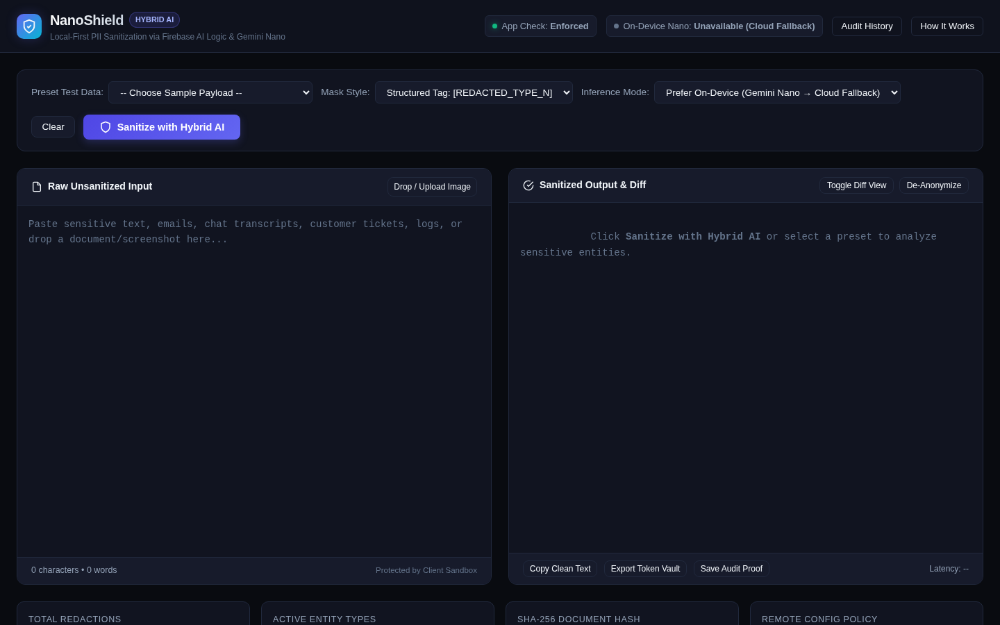
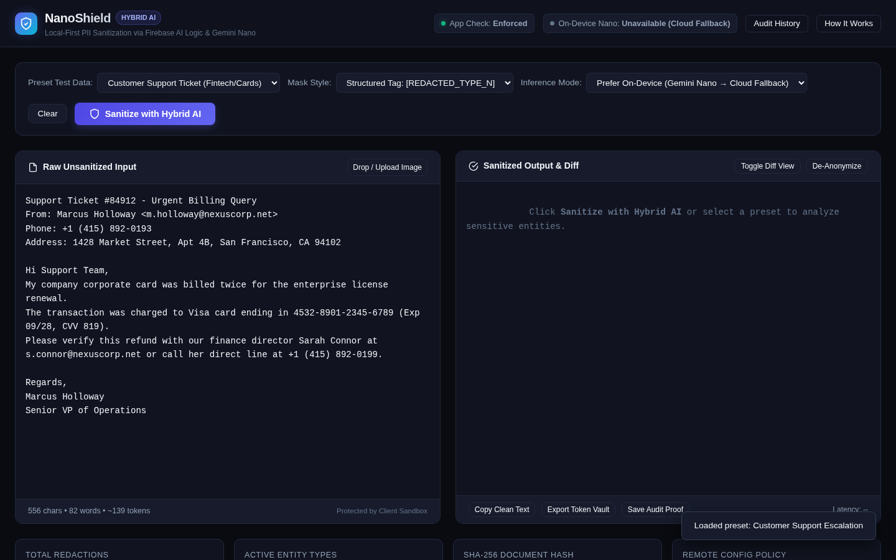
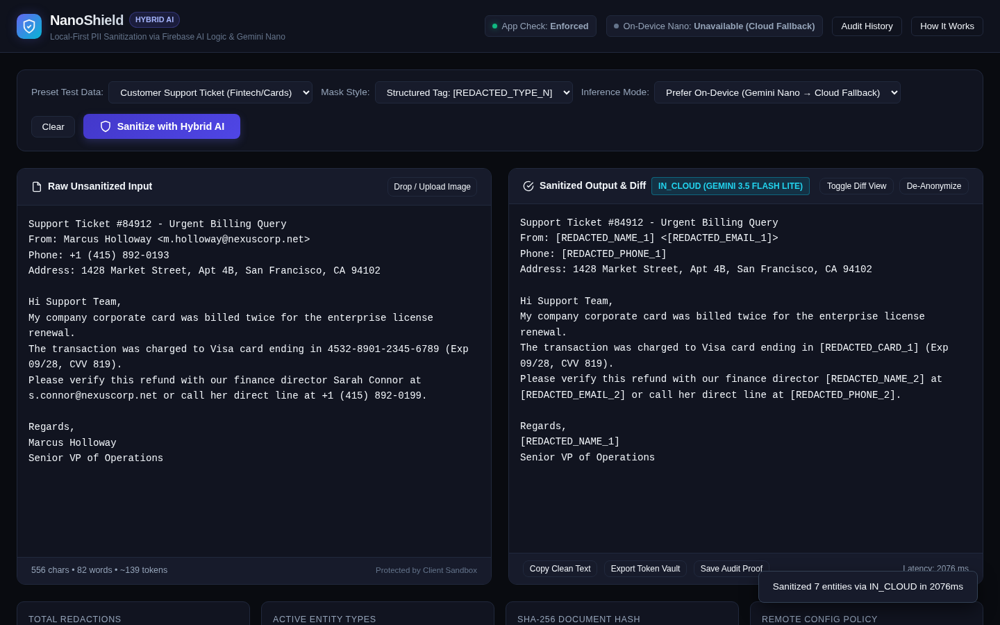
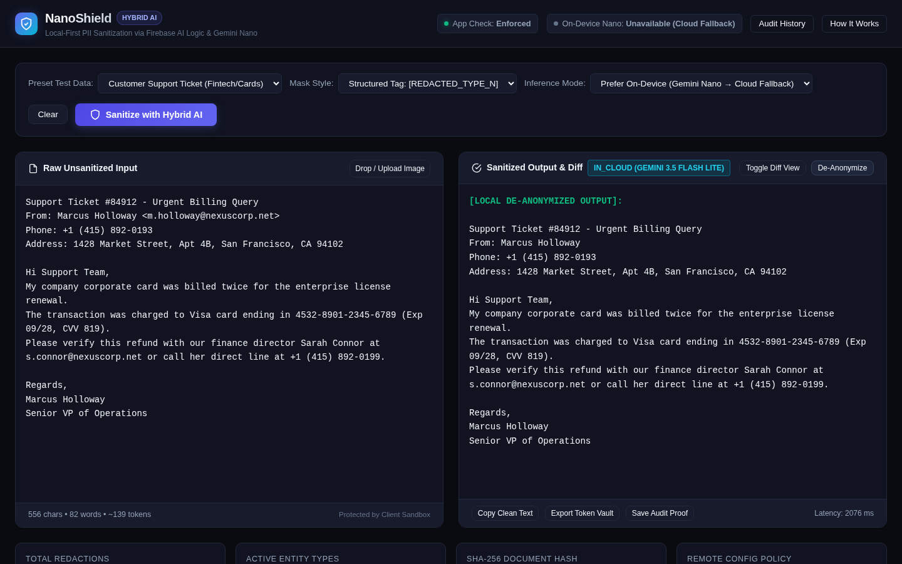
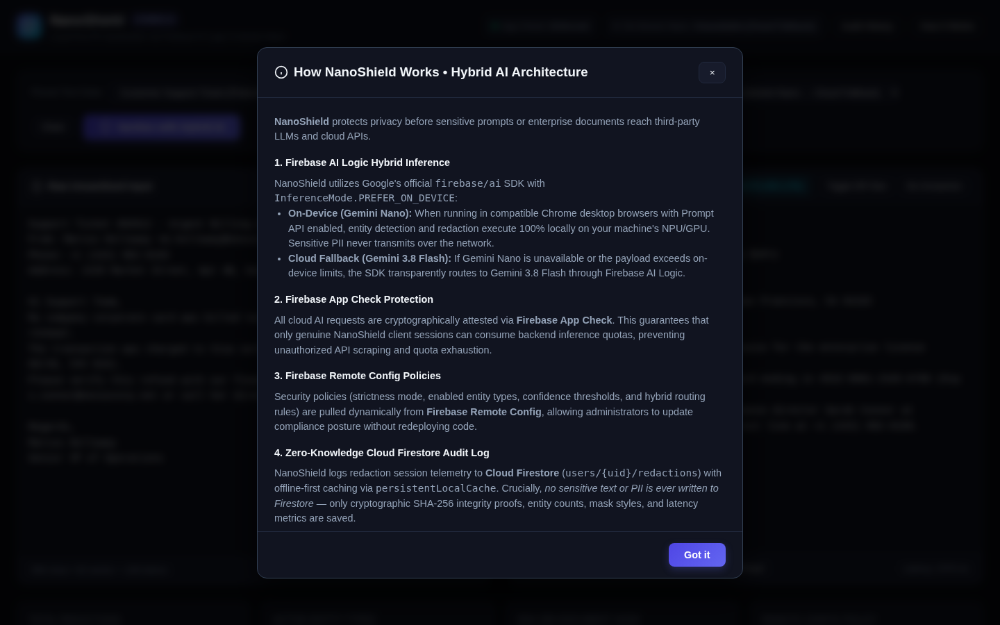
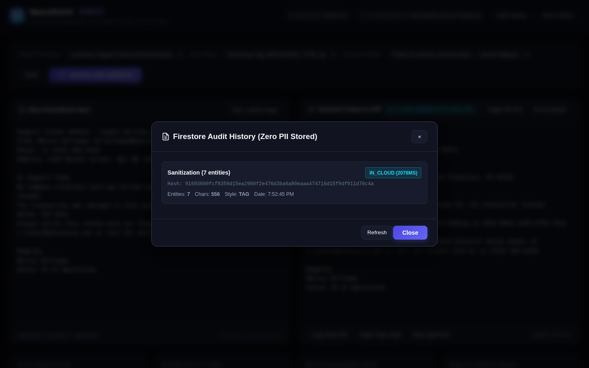

# NanoShield

Local-first PII redaction with **Firebase AI Logic** — on-device Gemini Nano when the browser supports it, with an honest cloud fallback to Gemini.

- **Live demo:** https://nanoshield-2026.web.app
- **Demo video:** https://youtu.be/t1ZOTRXctbw
- **Built for:** [#BuildHybridAI 2026](https://firebasehybridaihackathon.devpost.com/)
- **License:** Apache-2.0

## Why

People paste contracts, support tickets, logs and customer records into AI tools every day. NanoShield finds and masks the sensitive parts first — names, emails, phones, cards, national IDs, addresses and secrets — so the redacted text can be sent to any model. The reply is de-anonymized locally with a one-click swap.

## What it does

- Detects 7 PII categories: `NAME`, `EMAIL`, `PHONE`, `CARD`, `SSN`, `ADDRESS`, `SECRET`.
- Presets for customer support, legal, recruiting, finance and logs, plus strict mode and a confidence threshold.
- Mask styles: `[REDACTED_NAME_1]`, `****1234`, or a stable hash.
- Side-by-side diff, copy-clean, export/import an encrypted vault, and **De-Anonymize** to put real values back into a model reply.
- OCR for screenshots/images using the local canvas, with visual redaction boxes.
- Audit history in Firestore: SHA-256 integrity proof, entity counts, mask style and latency only — **no PII is written to Firestore**.

## Hybrid AI architecture

```
Browser
  ├─ Chrome Prompt API (Gemini Nano, on-device)  ← preferred
  │     window.ai.languageModel, Chrome 128+
  └─ Firebase AI Logic → Gemini (cloud)           ← fallback
        App Check attestation → model call
```

- `src/ai.js` creates the model with `InferenceMode.PREFER_ON_DEVICE`.
- When the Prompt API is available, the request is served on-device; otherwise Firebase AI Logic falls back to the cloud model.
- The UI badge always states which path served the request: **ON_DEVICE** or **IN_CLOUD (GEMINI …)**. The demo runs on Linux Chromium, where Nano is unavailable, so the honest label is `IN_CLOUD`.
- All AI Logic and Firestore calls are attested with **Firebase App Check** (reCAPTCHA v3 in production, registered debug token in local dev).
- **Remote Config** supplies the policy: strict mode, mask style, enabled entity types, hybrid policy and confidence threshold.
- **Anonymous Auth** gives a zero-friction session; Firestore uses `persistentLocalCache` for offline-first audit history.

## Privacy model

- **On-device mode:** no text leaves the browser.
- **Cloud fallback:** the submitted text is sent to Gemini through Firebase AI Logic for redaction; App Check attests the client. Use on-device mode when zero egress is required.
- The token map used by De-Anonymize lives in the browser tab only. It is never written to Firestore or any backend.
- Firestore records contain only a SHA-256 hash, counts, settings and latency.

## Stack

Firebase AI Logic · App Check · Anonymous Auth · Cloud Firestore · Remote Config · Vite · vanilla JS · local canvas OCR.

## Run locally

```bash
npm install
cp .env.example .env.local
# optional: put a registered App Check debug token in .env.local
npm run dev
```

Build and deploy:

```bash
npm run build
firebase deploy --only hosting
```

The Firebase web config in `src/firebase-config.js` is public. **Never commit** `.env.local`, App Check debug tokens, service accounts or private keys; `.gitignore` already excludes them.

## Smoke test

`test_nanoshield.mjs` drives the deployed app with Playwright and checks App Check, Remote Config, anonymous auth, a full sanitize run, de-anonymization and the audit modal:

```bash
node test_nanoshield.mjs
```

## Screenshots

| Landing | Preset |
|---|---|
|  |  |

| Sanitized + diff | De-anonymized |
|---|---|
|  |  |

| How it works | Audit history |
|---|---|
|  |  |

## License

Apache License 2.0 — see [LICENSE](LICENSE).
